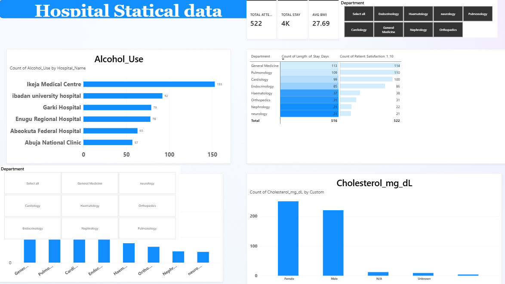

# Hospital Health Data Analysis | Power BI

An interactive Power BI dashboard built on a deliberately messy health dataset (1,500 patient records, 25 columns). The project covers data cleaning in Power Query, DAX measures and visual analysis, with recommendations for hospital decision-makers.

**Tool:** Power BI (Power Query, DAX)



---

## Project Overview

Hospital administrators need a clear view of patient volume, length of stay, patient satisfaction and health risk indicators across facilities and departments. This project simulates that scenario: starting from raw, inconsistent data, I cleaned and standardised it in Power Query and built an interactive report to surface insights.

## Business Questions

1. How many patients does each hospital and department attend to, and how long do they stay?
2. Which departments have the longest average stay and the lowest patient satisfaction?
3. How do health indicators (BMI, cholesterol, alcohol use) vary across hospitals and patient groups?
4. How are patients discharged across departments?
5. What actions could improve efficiency and patient outcomes?

## Dataset

| Item | Detail |
|---|---|
| Name | `messy_health_data_1500` |
| Rows | 1,500 |
| Columns | 25 |
| Facilities | Abeokuta Federal Hospital, Abuja National Clinic, Enugu Regional Hospital, Garki Hospital, Ibadan University Hospital, Ikeja Medical Centre |

**Fields used in the dashboard include:** `Hospital_Name`, `Department`, `Length_of_Stay_Days`, `Patient_Satisfaction_1_10`, `Cholesterol_mg_dL`, `Alcohol_Use`, `Discharge_Disposition`, BMI.

The data is synthetic and intentionally messy to practise real-world cleaning.

## Data Cleaning

Data quality issues addressed in Power Query:

- Inconsistent text casing and spelling in categorical fields (for example hospital names)
- Extra whitespace in text fields
- Missing values
- Incorrect data types
- Duplicate records
- Out-of-range values (satisfaction scores, BMI, cholesterol)

## Data Model and Measures

| Measure | Purpose |
|---|---|
| `TOTAL ATTENDANCE` | Total patient visits |
| `TOTAL STAY` | Total length of stay (days) |
| `AVG BMI` | Average body mass index |

Average length of stay, average satisfaction and average cholesterol are calculated with Average aggregations in the visuals.

## Dashboard

| Page | Contents |
|---|---|
| **Overview** | KPI cards (attendance, total stay, average BMI), department slicer, alcohol use by hospital, discharge disposition by department, cholesterol, department summary table |
| **Charts** | Focused chart view with department slicer |
| **Department Table** | Average length of stay and average satisfaction by department |

## Recommendations

1. **Reduce length of stay** in the departments with the highest averages by reviewing discharge planning and bed turnover.
2. **Target preventive screening and lifestyle programmes** at the patient groups with elevated cholesterol, BMI or alcohol use.
3. **Investigate satisfaction gaps** in the lowest-scoring departments through patient feedback and wait-time review.
4. **Standardise data entry** across facilities (naming, formats) to improve reporting quality.

## Repository Structure

```
├── README.md
├── Health Data.pbix
└── dashboard-overview.png
```

## How to Use

1. Download `Health Data.pbix` from this repository.
2. Open it in **Power BI Desktop** (free from Microsoft).
3. Use the Department slicer to explore the visuals across pages.

## Limitations

- The dataset is synthetic, so findings illustrate the analysis process and do not represent real hospitals.
- Results depend on the cleaning decisions made in Power Query.
- Patterns shown in the dashboard do not imply causation.

## Roadmap

- [ ] Add SQL queries to validate the dashboard figures
- [ ] Add an Excel summary workbook
- [ ] Add written key insights with figures from the dashboard

## Author

**[misaac-dataanalyst](https://github.com/misaac-dataanalyst)**, aspiring data analyst
